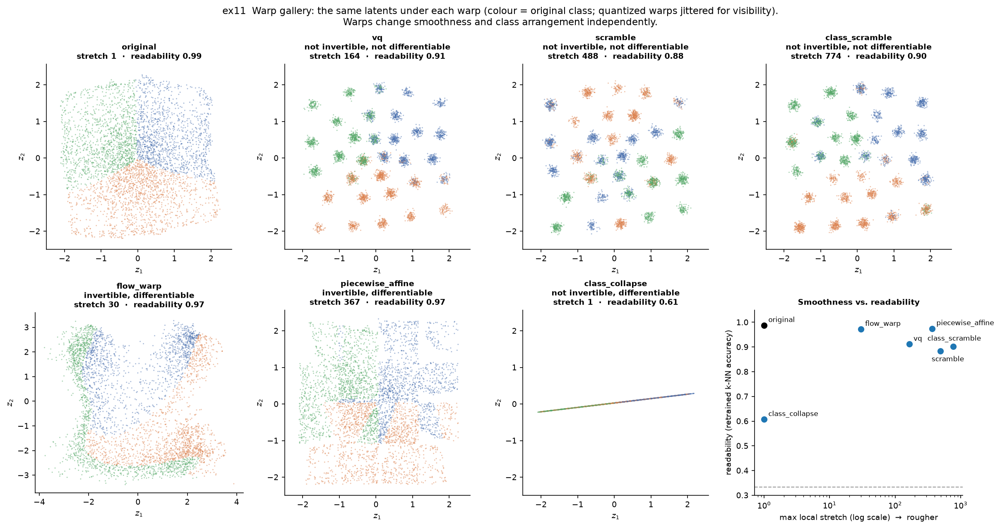

# latent_smoothness

Diagnostics for the geometry and smoothness of learned latent spaces, plus a small
library of controlled *latent warps* for ablation experiments.

Given a **decoder** `z → x`, a **classifier** `z → logits` and pre-computed latents,
`latent_smoothness` measures how smoothly the decoder and the classifier's decision
structure vary across the latent space: local Jacobians and pullback metrics,
perceptual and finite-difference roughness along paths, intrinsic dimensionality,
decision-boundary geometry, and label coherence. The warps (quantization, cell
scrambling, normalizing flows, piecewise-affine maps, class collapse) let you change
one property of a latent space, such as smoothness, information content or class
arrangement, while holding the others fixed, and then check what the diagnostics see.

Encoding is always the caller's job: the library only takes latent tensors and
`torch.nn.Module`s.


*The six warps applied to the 2-D latents of a toy VAE (colour = class), placed by how rough the
map is and whether the class information survives. See [`examples/`](examples/README.md) for
this and ten more worked examples.*

## Installation

From a clone of this repository:

```bash
pip install -e ".[all]"            # library + optional LPIPS and normalizing-flow support
pip install -e ".[all,examples,dev]"  # + matplotlib for the examples, pytest for the tests
```

Requires Python ≥ 3.10 and PyTorch ≥ 2.0. Optional extras:

| Extra | Installs | Needed for |
|-------|----------|-----------|
| `ppl` | `lpips` | `compute_ppl` and the PPL step of `DiagnosticSuite` |
| `flow` | `normflows` | `FlowWarp` / the `flow_warp` warp |
| `all` | both of the above | |

## Quick start

```python
import torch
from latent_smoothness import (
    compute_jacobian_spectrum, compute_boundary_trajectory, linear_interpolate,
    DiagnosticSuite, SuiteConfig,
)

z = encoder(x)                                   # (N, dz), your encoder
jac = compute_jacobian_spectrum(decoder, z)
print(f"Lipschitz estimate: {jac.lipschitz_estimate:.3f}")

paths = linear_interpolate(z[:16], z[16:32], n_steps=50)   # (16, 50, dz)
print(compute_boundary_trajectory(classifier, paths).n_crossings)

# Or everything at once, on a reference set, a query set and M straight paths:
endpoints = torch.stack([z_start, z_end], dim=1)           # (M, 2, dz)
suite = DiagnosticSuite(decoder, classifier, SuiteConfig())
result = suite.run(z_reference=z_a, z_query=z_b, trajectory_endpoints=endpoints)
print(result.summary_table())
scalars = result.to_scalars()                    # flat {name: float}, e.g. for a logger
```

Warps share one interface:

```python
from latent_smoothness.warp import build_warp

warp = build_warp("piecewise_affine", fit_data=z, bins_per_dim=4, seed=0)
z_w = warp.forward(z)                 # warped latents, same shape/device/dtype
z_back = warp.backproject(z_w)        # exact inverse here (warp.is_invertible)
warp.save("warp.pt"); warp = type(warp).load("warp.pt")
```

## Conventions

- **Decoder**: `(B, dz) → (B, ...)`. `compute_ppl` needs image output `(B, C, H, W)`.
- **Classifier**: `(B, dz) → (B, C)` logits. All boundary and alignment quantities use the
  **decision margin** of a class `c`, `m(z) = l_c(z) − max_{j≠c} l_j(z)`, which is positive
  exactly where `c` is the predicted class. A single-output classifier is treated as binary and
  its logit is used directly (`latent_smoothness.decision_margin`).
- Every diagnostic puts the modules in `eval()` mode for the computation and restores their
  previous train/eval state afterwards.
- `device=None` (the default for LPIPS and the suite) means CUDA if available, else CPU.

## Diagnostics

| Function | What it measures | Needs gradients |
|----------|------------------|:---:|
| `compute_jacobian_spectrum` | Singular values of the decoder Jacobian per point; Lipschitz estimate; flags degenerate (≈0) Jacobians | yes |
| `compute_pullback_metric` | Pullback metric `G = JᵀJ` and its (log-)determinant | yes |
| `compute_geodesic_discrepancy` | Output-space arc length of the straight latent path vs. its chord, `(arc − chord) / chord` | yes |
| `compute_ppl` | Per-segment LPIPS distance along paths, with spike detection | no |
| `compute_secant_roughness` | Secant ratio `‖f(z+Δ) − f(z)‖ / ‖Δ‖` across step scales and its log–log slope | no |
| `compute_lid` | Local intrinsic dimensionality (TwoNN and Levina–Bickel MLE) | no |
| `compute_boundary_geometry` | Decision margin, margin-gradient norm and Hessian curvature per point | yes |
| `compute_boundary_trajectory` | Decision-boundary crossings along paths | no |
| `compute_gradient_alignment` | Cosine between latent displacements and the margin gradient | yes |
| `compute_label_coherence` | Argmax flips and monotonic gain of P(target) along paths | no |
| `compute_label_dimensionality` | Within-class effective rank/spread, class-mean arrangement rank, Fisher ratio | no |
| `estimate_mi` | MINE estimate of the mutual information `I(z; W(z))` | no |

The gradient-free diagnostics stay meaningful for non-differentiable maps (e.g. the `vq` and
`scramble` warps), whose Jacobians are zero almost everywhere.

## Warps

| Name | Invertible | Differentiable | Description |
|------|:---:|:---:|-------------|
| `vq` | – | – | Snap to the nearest of `codebook_size` K-means centroids |
| `scramble` | – | – | `vq`, then a random permutation of the codebook cells (a bijection on cells) |
| `class_scramble` | – | – | `vq`, then swaps of cells of the same (`class_mode="within"`) or different (`"across"`) class; needs `labels` |
| `flow_warp` | ✓ | ✓ | Normalizing flows mapping the latent distribution onto a target distribution |
| `piecewise_affine` | ✓ | ✓ | Random signed axis permutation within each grid cell: affine inside a cell, discontinuous across cells |
| `class_collapse` | – | ✓ | Linear projection removing the top principal axes of the class-mean cloud; needs `labels` |

Non-invertible warps implement `backproject` as best-effort recovery. Non-differentiable warps
provide `forward_ste`, a straight-through estimator with an identity gradient.

## Examples

`examples/` contains eleven runnable scripts, one per diagnostic or warp, on small toy models.
Each one saves a figure and asserts its expected outcome. The
[examples README](examples/README.md) shows every figure with a short explanation;
`python examples/run_all.py` runs them all.

## Tests

```bash
pytest -m "not slow" -n auto    # fast suite (under a minute on a laptop CPU)
pytest -n auto                  # everything, incl. LPIPS-based tests (downloads VGG weights)
```

## Known limitations

- **Per-point Jacobians.** Jacobian-based diagnostics loop over points and backpropagate one
  output dimension per row. That is exact but slow for large decoders or many points; subsample
  (e.g. `SuiteConfig(n_samples=...)`).
- **GPU path.** Development and testing were done on CPU. The code is device-agnostic, but the
  CUDA path has no automated test coverage.
- **"Geodesic" is the straight path.** `compute_geodesic_discrepancy` measures the output-space
  length of the *straight* latent path, not a shortest path under the pullback metric. The
  fixed-step `euler`/`rk4` solvers can slightly undershoot the chord on very smooth decoders
  (small negative discrepancies).
- **MINE bias.** The Donsker–Varadhan estimate has a finite-sample positive bias (≈0.2 nats for
  independent 4-d Gaussians at N=1024). It also underestimates MI for bijections over many cells
  (e.g. a 64-cell scramble), because the critic cannot learn all cell associations
  (see `examples/ex09_mine_verification.py`).
- **Boundary curvature for some warps.** `compute_boundary_geometry` uses `torch.func.hessian`.
  For the quantizing warps (`vq`, `scramble`) the reported curvature of 0 is real, since those
  maps are piecewise constant. `piecewise_affine` hashes cell indices in NumPy, so `torch.func`
  cannot trace it, and its curvature is reported as 0 with a warning. That value is a tooling
  limit, not a smoothness reading. Ordinary autograd (and therefore its Jacobian) is unaffected.
- **Windows / scikit-learn.** K-means runs with single-threaded OpenMP to avoid a thread-pool
  deadlock seen with some scikit-learn versions on Windows.

## License

MIT, see [LICENSE](LICENSE).
