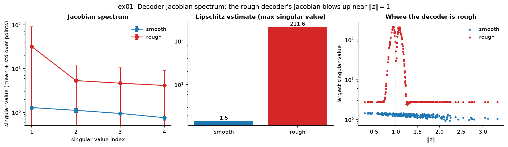
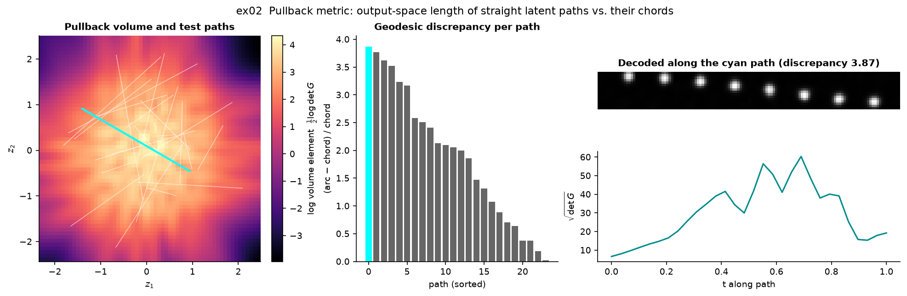
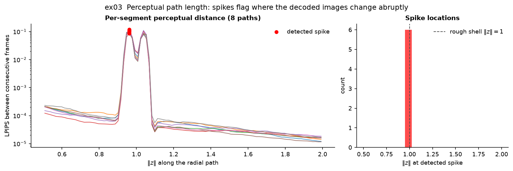
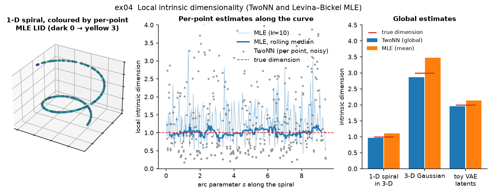
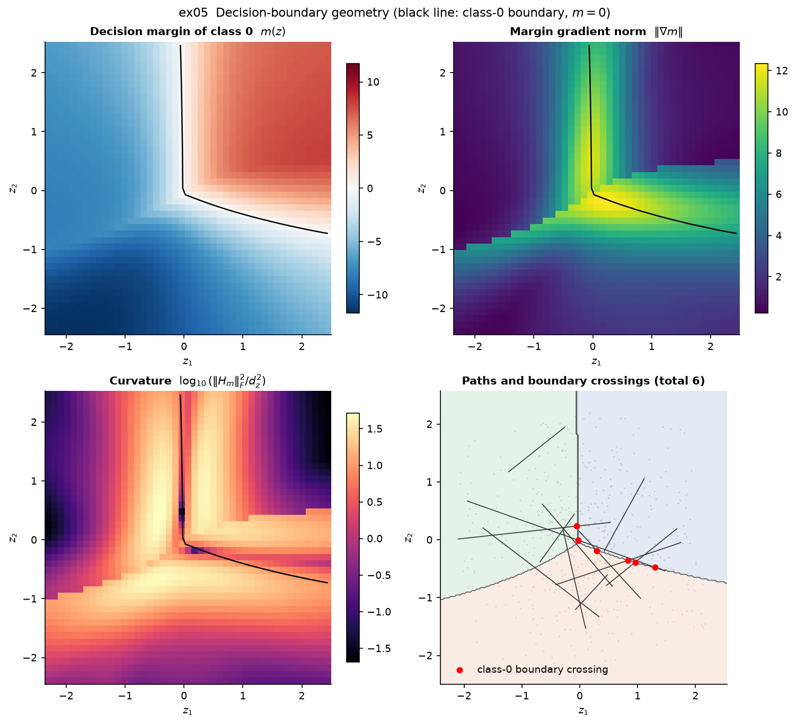
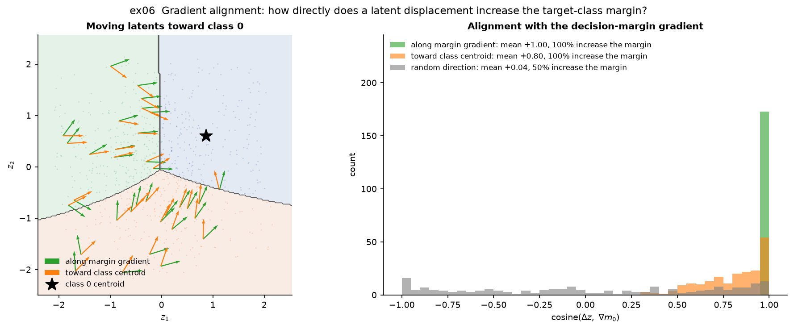
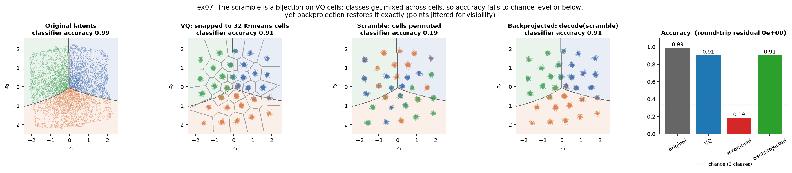
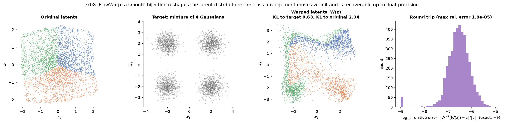
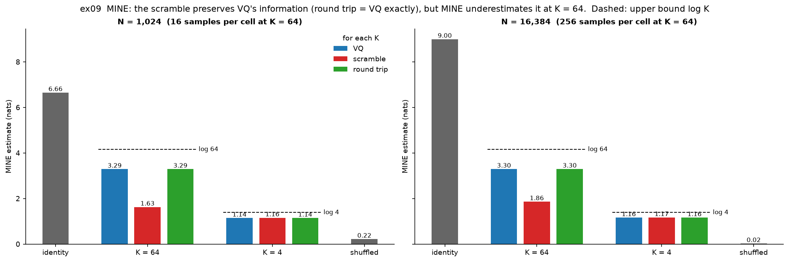
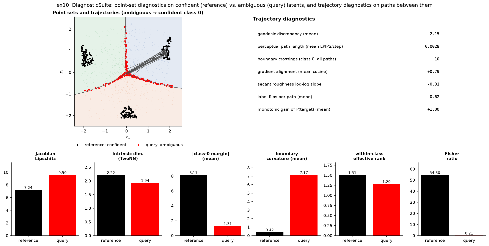

# Examples

Eleven small, self-contained scripts, each demonstrating one diagnostic or warp. Every
script saves a figure and ends with a pass/fail check of its expected outcome.

```bash
pip install -e ".[all,examples]"
python examples/run_all.py                    # all examples, figures -> examples/outputs/
python examples/ex05_boundary_geometry.py     # or a single one
python examples/run_all.py --update-figures   # refresh the figures shown below
```

Most examples share a **toy model** (`toy_models.py`). It is a VAE with a 2-D latent space,
trained on 16×16 images of a Gaussian bump at a continuous position, so the latent space
is a smooth 2-D sheet of bump positions. A small classifier on the latents assigns three
classes by the bump's angle sector, so the classes meet at the image centre. Training
takes about 30 seconds on a CPU, and the trained models are cached in `examples/outputs/`.

| Script | Shows |
|--------|-------|
| [`ex01_jacobian_spectrum.py`](ex01_jacobian_spectrum.py) | Decoder Jacobian spectrum and where a decoder is rough |
| [`ex02_geodesic_discrepancy.py`](ex02_geodesic_discrepancy.py) | Pullback metric and output-space path length |
| [`ex03_ppl_profile.py`](ex03_ppl_profile.py) | Perceptual path length and spike detection |
| [`ex04_lid_along_trajectory.py`](ex04_lid_along_trajectory.py) | Local intrinsic dimensionality |
| [`ex05_boundary_geometry.py`](ex05_boundary_geometry.py) | Decision margin, gradient, curvature and boundary crossings |
| [`ex06_gradient_alignment.py`](ex06_gradient_alignment.py) | Alignment of latent displacements with the margin gradient |
| [`ex07_vq_scramble_comparison.py`](ex07_vq_scramble_comparison.py) | `vq` and `scramble` warps, exact backprojection |
| [`ex08_flow_warp.py`](ex08_flow_warp.py) | `flow_warp`: a learned smooth bijection |
| [`ex09_mine_verification.py`](ex09_mine_verification.py) | MINE mutual information, and where it fails |
| [`ex10_full_suite.py`](ex10_full_suite.py) | `DiagnosticSuite` on confident vs. ambiguous latents |
| [`ex11_warp_gallery.py`](ex11_warp_gallery.py) | All six warps by smoothness and readability |

---

### ex01: Jacobian spectrum



A smooth MLP decoder is compared with a linear decoder whose input is rescaled by a narrow
bump at `‖z‖ = 1`. The spectra and Lipschitz estimates show *that* the second decoder is rough.
The per-point largest singular value against `‖z‖` (right) shows *where*: the rough decoder's
Jacobian jumps by two orders of magnitude exactly on that shell.

### ex02: Pullback metric and geodesic discrepancy



The heat map is the pullback volume element `½ log det G` of the toy decoder: how much image
space a unit of latent area covers. It is largest in the centre of the sheet. For straight latent
paths, the output-space arc length is compared with the output-space chord. Images of a bump at two
distant positions barely overlap, so the chord saturates while the arc keeps growing, and long paths
through the high-volume centre get the largest discrepancies. The right panels show the decoded
images and `√det G` along the most curved path.

### ex03: Perceptual path length



An 8×8 image decoder with a thin rough shell at `‖z‖ = 1`, probed along radial paths from
`‖z‖ = 0.5` to `2`. The LPIPS distance between consecutive frames is flat except at the shell,
where it rises by three orders of magnitude, and every detected spike lies on the shell. The shell
causes a double peak (entering and leaving). The detector reports at most one spike per path, and
the twin peak raises its local baseline, so a few paths are not flagged.

### ex04: Local intrinsic dimensionality



TwoNN and Levina–Bickel MLE estimates for a 1-D spiral in 3-D, a 3-D Gaussian, and the 2-D toy
latents. Per-point estimates (middle) are noisy, but their rolling median and the global estimates
(right) recover the true dimension.

### ex05: Decision-boundary geometry



All quantities are computed on the decision margin `m(z) = l₀ − max_{j≠0} l_j` of class 0, whose
zero level set (black line) is the class-0 decision boundary. The margin gradient concentrates near
the boundary, and the curvature shows where the boundary bends, including the kink where class 0's
strongest competitor switches. Bottom right: straight latent paths and the points where they cross
the class-0 boundary.

### ex06: Gradient alignment



Latents from classes 1 and 2 are moved toward class 0 in three ways: along the margin gradient,
straight toward the class-0 centroid, and in a random direction. The cosine with the margin gradient
is 1 by construction for the first, high but not perfect for the centroid heuristic, and centred on
0 for random moves.

### ex07: VQ and bijective scramble



`vq` snaps latents to 32 K-means cells. `scramble` additionally permutes the cells, which keeps all
of VQ's information but destroys the spatial class arrangement: the original classifier drops to
chance level or below. Backprojection inverts the permutation exactly and restores VQ's accuracy,
with a round-trip residual of 0.

### ex08: Flow warp



`FlowWarp` learns a smooth bijection from the latent distribution toward a target (here, a mixture
of four Gaussians). The class arrangement is carried along continuously, and the inverse recovers
the original latents up to float precision.

### ex09: MINE mutual information



For `z ~ N(0, I₄)`, VQ with K cells keeps at most `log K` nats (dashed lines). The scramble must keep
exactly as much as VQ, because it permutes the cells. At K = 4, MINE recovers this (VQ ≈ scramble ≈
round trip). At K = 64 it underestimates the scramble, even with 256 samples per cell: the critic
would have to learn 64 arbitrary cell-to-cell associations. The round trip still equals VQ, which
shows that this is an estimation limit, not information loss.

### ex10: The full DiagnosticSuite



`DiagnosticSuite.run` on two point sets: the most confidently classified latents (reference) and
the most ambiguous ones (query), which lie on the decision boundaries. Paths run from ambiguous
latents to confident class-0 latents. Ambiguous latents have small margins, high boundary curvature
and no class separation (Fisher ratio ≈ 0).

### ex11: Warp gallery


The same latents under every warp, coloured by their original class. Each warp is placed by its
**max local stretch** (largest secant ratio at the smallest step; it explodes for maps that jump
across cell boundaries) and its **readability** (accuracy of a classifier *retrained* on the warped
latents). The warps vary these independently: `piecewise_affine` is rough but fully readable,
`class_collapse` is perfectly smooth but loses class information, and `flow_warp` stays smooth and
readable.
