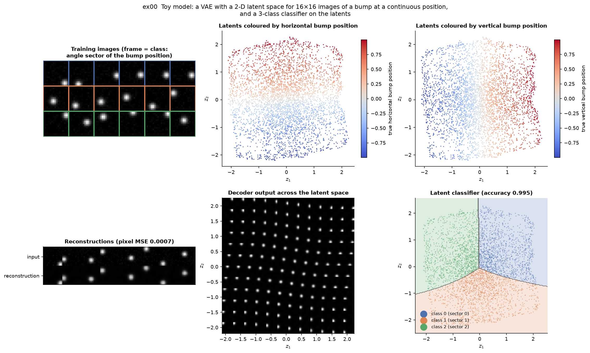
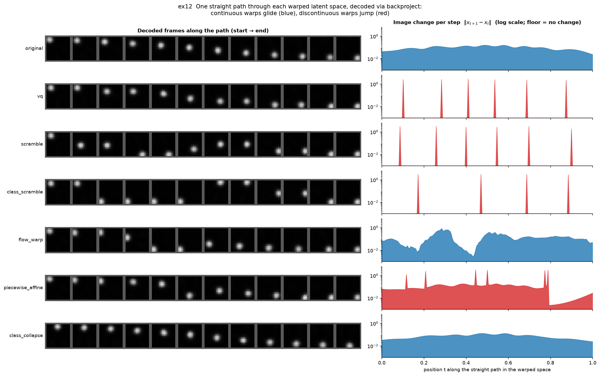

# Examples

Thirteen small, self-contained scripts: an overview of the shared toy model, one per
diagnostic or warp, and two that compare all warps. Every
script saves a figure and ends with a pass/fail check of its expected outcome.

```bash
pip install -e ".[all,examples]"
python examples/run_all.py                    # all examples, figures -> examples/outputs/
python examples/ex05_boundary_geometry.py     # or a single one
python examples/run_all.py --update-figures   # refresh the figures shown below
```

Most examples share a **toy model** (`toy_models.py`). It is a VAE with a 2-D latent space,
trained on 16×16 images of a Gaussian bump at a continuous position, so the latent space
is a smooth 2-D sheet of bump positions. A small classifier on the latents assigns three
classes by the bump's angle sector, so the classes meet at the image centre. Training
takes about 20 seconds on a CPU (single-threaded, so it is reproducible), and the trained
models are cached in `examples/outputs/`.

| Script | Shows |
|--------|-------|
| [`ex00_toy_model.py`](ex00_toy_model.py) | The toy model: data, latent space, reconstructions, classifier |
| [`ex01_jacobian_spectrum.py`](ex01_jacobian_spectrum.py) | Decoder Jacobian spectrum and where a decoder is rough |
| [`ex02_geodesic_discrepancy.py`](ex02_geodesic_discrepancy.py) | Pullback metric and output-space path length |
| [`ex03_ppl_profile.py`](ex03_ppl_profile.py) | Perceptual path length and spike detection |
| [`ex04_lid_along_trajectory.py`](ex04_lid_along_trajectory.py) | Local intrinsic dimensionality |
| [`ex05_boundary_geometry.py`](ex05_boundary_geometry.py) | Decision margin, gradient, curvature and boundary crossings |
| [`ex06_gradient_alignment.py`](ex06_gradient_alignment.py) | Alignment of latent displacements with the margin gradient |
| [`ex07_vq_scramble_comparison.py`](ex07_vq_scramble_comparison.py) | `vq` and `scramble` warps, exact backprojection |
| [`ex08_flow_warp.py`](ex08_flow_warp.py) | `flow_warp`: a learned smooth bijection |
| [`ex09_mine_verification.py`](ex09_mine_verification.py) | MINE mutual information, and where it fails |
| [`ex10_full_suite.py`](ex10_full_suite.py) | `DiagnosticSuite` on confident vs. ambiguous latents |
| [`ex11_warp_gallery.py`](ex11_warp_gallery.py) | All six warps by smoothness, readability and class arrangement |
| [`ex12_decoded_paths.py`](ex12_decoded_paths.py) | Roughness made visible: one path through each warped space, decoded |

---

### ex00: The toy model



Training images show a single bump, and the frame colour is the class, i.e. the angle sector of the
bump position. Colouring the latents by the true horizontal and vertical bump position shows that
the VAE has recovered both generative factors as a smooth 2-D sheet. It happens to encode the
horizontal position along `z₂` and the vertical along `z₁`, a rotation that does not matter. The
decoded grid (bottom middle) shows the bump moving continuously across the latent space, and the
latent classifier separates the three sectors, which meet near the centre of the sheet.

### ex01: Jacobian spectrum


A smooth MLP decoder is compared with a linear decoder whose input is rescaled by a narrow
bump at `‖z‖ = 1`. The spectra and Lipschitz estimates show *that* the second decoder is rough.
The per-point largest singular value against `‖z‖` (right) shows *where*: the rough decoder's
Jacobian jumps by two orders of magnitude exactly on that shell.

### ex02: Pullback metric and geodesic discrepancy


The heat map is the pullback volume element `½ log det G` of the toy decoder: how much image
space a unit of latent area covers. It is largest in the centre of the sheet. For straight latent
paths, the output-space arc length is compared with the output-space chord. Images of a bump at two
distant positions barely overlap, so the chord saturates while the arc keeps growing, and long paths
through the high-volume centre get the largest discrepancies. The right panels show the decoded
images and `√det G` along the most curved path.

### ex03: Perceptual path length


An 8×8 image decoder with a thin rough shell at `‖z‖ = 1`, probed along radial paths from
`‖z‖ = 0.5` to `2`. The LPIPS distance between consecutive frames is flat except at the shell,
where it rises by three orders of magnitude, and every detected spike lies on the shell. The shell
causes a double peak (entering and leaving). The detector reports at most one spike per path, and
the twin peak raises its local baseline, so a few paths are not flagged.

### ex04: Local intrinsic dimensionality


TwoNN and Levina–Bickel MLE estimates for a 1-D spiral in 3-D, a 3-D Gaussian, and the 2-D toy
latents. Per-point estimates (middle) are noisy, but their rolling median and the global estimates
(right) recover the true dimension.

### ex05: Decision-boundary geometry


All quantities are computed on the decision margin `m(z) = l₀ − max_{j≠0} l_j` of class 0, whose
zero level set (black line) is the class-0 decision boundary. The margin changes fastest in a band
around the boundary. The curvature panel shows the size of the margin's Hessian, which is largest in
the transition zones where the classifier's units saturate and along the line where class 0's
strongest competitor switches between classes 1 and 2 (a kink in the margin). It is a property of
the margin function, not of the boundary line's shape. Bottom right: straight latent paths and the
points where they cross the class-0 boundary.

### ex06: Gradient alignment


Latents from classes 1 and 2 are moved toward class 0 in three ways: along the margin gradient,
straight toward the class-0 centroid, and in a random direction. The cosine with the margin gradient
is 1 by construction for the first, high but not perfect for the centroid heuristic, and centred on
0 for random moves.

### ex07: VQ and bijective scramble


`vq` snaps latents to 32 K-means cells. `scramble` additionally permutes the cells, which keeps all
of VQ's information but destroys the spatial class arrangement: the original classifier drops to
chance level or below. Backprojection inverts the permutation exactly and restores VQ's accuracy,
with a round-trip residual of 0.

### ex08: Flow warp


`FlowWarp` learns a smooth bijection from the latent distribution toward a target (here, a mixture
of four Gaussians). The class arrangement is carried along continuously, and the inverse recovers
the original latents up to float precision.

### ex09: MINE mutual information


For `z ~ N(0, I₄)`, VQ with K cells keeps at most `log K` nats (dashed lines). The scramble must keep
exactly as much as VQ, because it permutes the cells. At K = 4, MINE recovers this (VQ ≈ scramble ≈
round trip). At K = 64 it underestimates the scramble, even with 256 samples per cell: the critic
would have to learn 64 arbitrary cell-to-cell associations. The round trip still equals VQ, which
shows that this is an estimation limit, not information loss.

### ex10: The full DiagnosticSuite


`DiagnosticSuite.run` on two point sets: the most confidently classified latents (reference) and
the most ambiguous ones (query), which lie on the decision boundaries. Paths run from ambiguous
latents to confident class-0 latents. Ambiguous latents have small margins, high boundary curvature
and no class separation (Fisher ratio ≈ 0).

### ex11: Warp gallery


The same latents under every warp, coloured by their original class. Three numbers characterise
each warp:

- **stretch:** the largest secant ratio at the smallest step. It explodes for maps that jump across
  cell boundaries.
- **readability:** the accuracy of a classifier *retrained* on the warped latents, i.e. whether the
  class information survives.
- **arrangement:** the accuracy of the *original* classifier on the warped latents, i.e. whether
  classes stay where they were.

The warps vary these independently. `scramble` and within-class `class_scramble` are equally rough
and equally readable, but only the latter keeps the class arrangement. `piecewise_affine` is rough
but fully readable. `class_collapse` is perfectly smooth but loses class information. `flow_warp`
stays smooth and readable while moving the classes around.

### ex12: Decoded paths through the warped latent spaces



What the stretch numbers of ex11 mean for generated images. The same two latents are mapped into
each warped space, the straight line between them is walked there, and every step is decoded via
`decoder(warp.backproject(z'))`. In the original space the bump glides from corner to corner.
`vq` moves it in discrete steps. `scramble` and `class_scramble` make it teleport whenever the path
enters a new cell, and `piecewise_affine` jumps at cell boundaries while moving smoothly inside each
cell. `flow_warp` never jumps, but where the path crosses a low-density region the bump sweeps across
the image within a few steps, which is the flow's large local stretch. `class_collapse` glides
smoothly, but its start and end images differ from the original ones, because the collapse has
discarded that information.
